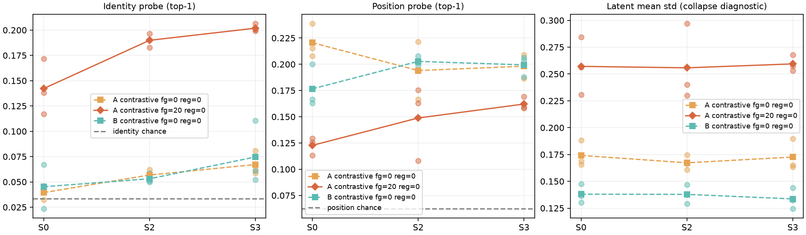
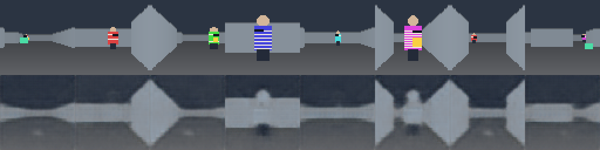
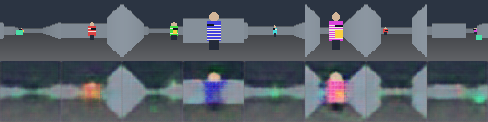

# RTX 4060 本地预实验（2026-10-18）

本轮把原型推进到真实 GPU 训练与冻结表征评测。结果是**探索性工程预实验**：已找到会改变身份信息留存的训练损失因素，但尚未训练控制策略，不能声称实现了“近乎免费的隐私”。全部人物均为程序化虚拟外观。

## 运行条件与可复现设置

- 设备：NVIDIA GeForce RTX 4060 Laptop GPU，8 GB 显存；驱动 617.14；Python 3.12；PyTorch 2.9.1+cu128。`pytest` 为 8 passed。
- 开发数据：采集种子 0；S0（整回合稳定）、S2（每步独立随机）、S3（30 身份周期循环）。每种条件有世界模型训练及探针训练/验证/测试四份互斥回合数据，每份 90 回合、每回合 60 次转移。三条件共用物理轨迹，身份画面按时间结构重渲染。数据清单 SHA-256：`7b1fa8205c2e2cc8af596d2c9537d6bb7db605efb8542ae0391c5b3dec7ee3f7`。
- 模型：相同的 64×64 RGB 编码器、32 维潜状态、动作条件动力学头；批量 64，Adam 学习率 0.001，1,500 步。A = 批内对比式下一帧预测 + 50 倍像素重建；B = 相同的对比式预测。温度 0.2，防坍塌正则为 0。每种设置使用配对的训练种子 0、1、2，编码器初始化和训练批次在同种子 A/B 间对齐。
- `A/前景20` 是单独的探索性变量：输入画面中 RGB 最大与最小通道差大于 0.2 的像素，其重建误差乘以 21；其余像素权重为 1。它不使用身份标签，但也会覆盖彩色文件夹，不等于准确的人物分割。
- 身份探针在验证集选择线性、MLP 或 k-NN 家族，独立测试集报告 top-1；人物物理中心可见帧参与评测。位置探针是人物绝对位置的 4×4 分箱，**不是**策略任务成功率。身份随机机会水平为 3.3%，位置为 6.25%。

最初的单步 MSE 预测 B 在 600 步时出现表示坍塌：无正则时测试潜状态平均标准差约 0.003、有效秩约 1.35；正则 0.1 时仍约为 0.023、1.18。因此保留 MSE 运行作为失败基线，改用批内对比式预测开展下表的可读出实验。对比式预测的有效秩约为 9–13，训练损失也由约 `log(64)` 降至约 2，但它仍可能利用场景中的捷径。

## 开发数据上的配对结果

下表为三个训练种子的测试集均值；括号是三个种子的最小值–最大值，**不是置信区间**。原始像素 B0 是 16×16 下采样、训练集拟合 PCA 后的经验参考，不是理论上界。

| 时间结构 | 模型 | 身份 top-1 | 位置 top-1 | 有效秩均值 | 像素身份参考 B0 |
| --- | --- | ---: | ---: | ---: | ---: |
| S0 | A/普通重建 | 3.9%（3.2–4.6） | 22.1% | 10.9 | 约 40.0% |
| S0 | B/预测 | 4.5%（2.4–6.7） | 17.7% | 12.4 | 约 40.0% |
| S0 | A/前景20 | 14.2%（11.7–17.2） | 12.3% | 10.1 | 约 40.0% |
| S2 | A/普通重建 | 5.7%（5.3–6.2） | 19.4% | 11.0 | 约 54.7% |
| S2 | B/预测 | 5.3%（5.0–5.8） | 20.3% | 12.6 | 约 54.7% |
| S2 | A/前景20 | 19.0%（18.3–19.7） | 14.9% | 9.9 | 约 54.7% |
| S3 | A/普通重建 | 6.7%（5.8–8.1） | 19.8% | 10.8 | 约 54.1% |
| S3 | B/预测 | 7.5%（5.2–11.1） | 19.9% | 12.5 | 约 54.1% |
| S3 | A/前景20 | 20.2%（19.9–20.6） | 16.2% | 9.6 | 约 54.1% |

在九个“时间结构 × 训练种子”的配对中，`A/前景20` 相比同种子的普通 A，身份准确率均上升约 8.5–14.8 个百分点，位置准确率均下降约 1.9–11.3 个百分点。这个方向与视觉检查一致：普通 A 重建了走廊却基本抹掉人物衣着；前景加权 A 恢复了部分衣着颜色。种子 0 的可见帧上，前景色彩区域的 MSE 在 S0/S2/S3 从约 0.089 降至 0.019/0.022/0.026，背景 MSE 则从约 0.0025 升至约 0.006。当前证据说明**损失的像素权重改变了潜状态在身份外观与场景几何之间的分配**；普通 A 与 B 的排序并不稳定支持原假设。



普通重建与前景加权的同一批测试画面对照：





27 次开发数据训练的 PyTorch 张量峰值分配不超过 128.4 MiB；这**不包括** CUDA 上下文、框架缓存和其他进程占用。单次训练约 13–20 秒，27 次合计约 447 秒，另有探针评测时间。模型权重与完整输出保存在本机 `prototype/outputs/gpu4060_nce_pilot/`，不进入 Git；可分享的逐运行指标在 [机器可读摘要](evidence/gpu4060_experiments.json)。

## 新数据上的固定配置复验

确定上述设置后，另用采集种子 41 生成全新的 S0 四份数据（各 90 回合，清单 SHA-256：`c53ee530cdecf6d8bb5f489439688cdca5860745572ec490bbe748745c591457`），未再调整损失系数。单一训练种子的结果如下：

| 模型 | 身份 top-1 | 位置 top-1 | 有效秩 |
| --- | ---: | ---: | ---: |
| A/普通重建 | 7.7% | 25.3% | 10.9 |
| B/预测 | 4.2% | 25.5% | 12.2 |
| A/前景20 | 20.2% | 20.1% | 9.2 |

新数据的原始像素身份参考是 45.6%。前景加权造成的身份上升、位置下降方向再次出现，但只有一个新数据种子，仍不能推广到其他环境或真人图像。

## 结论边界与下一步

本轮没有冻结表征上的策略训练，也没有 P1/P2/P3 学得的策略消融；绝对位置探针只能作为辅助诊断。人物与文件夹占画面很小，色彩阈值同时覆盖其他彩色物体，场景仍是二维网格物理加第一视角投影。开发数据的测试集曾被用于发现坍塌并选择前景加权，因此开发数据结果全部属于探索性分析；新 S0 数据只提供一次方向复验。不能用上述结果宣称“近乎免费隐私”或部署级防护。

下一阶段先增加与任务直接相关的冻结表征策略/行为克隆成功率和人物相对方位、持物状态探针，再做 P1/P2/P3。随后固定损失方案，在新采集的 S0/S2/S3 数据和至少三个独立训练种子上做配对评估，并预先确定效应与等价判据。

在 `prototype` 目录可用以下命令复跑同规模实验；输出目录需换成尚不存在的名称：

```powershell
..\.venv\Scripts\python.exe -m privacywm collect --output outputs/reproduce4060 --episodes 90 --horizon 60 --seed 0 --modes S0 S2 S3
..\.venv\Scripts\python.exe -m privacywm preflight --output outputs/reproduce4060
foreach ($s in 0..2) {
    ..\.venv\Scripts\python.exe -m privacywm train --output outputs/reproduce4060 --modes S0 S2 S3 --models A B --steps 1500 --regularization 0 --prediction-objective contrastive --seed $s --device cuda
    ..\.venv\Scripts\python.exe -m privacywm train --output outputs/reproduce4060 --modes S0 S2 S3 --models A --steps 1500 --regularization 0 --prediction-objective contrastive --foreground-weight 20 --seed $s --device cuda
}
```
